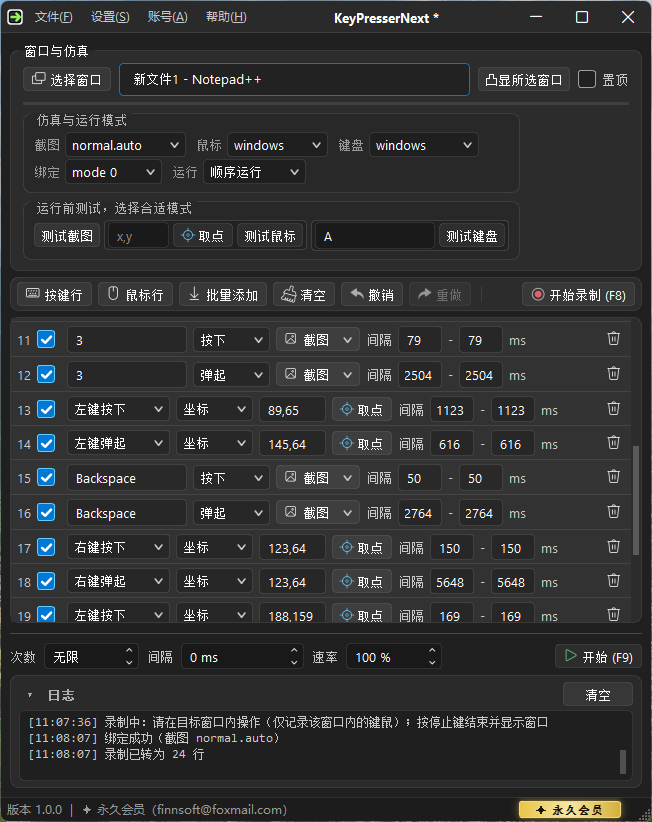

# KeyPresserNext Community

Windows 桌面自动化工具：统一按键 / 鼠标 / 识图行编辑器。

**录得下，改得动，跑得稳。**

需要安装包与自动更新，可访问 [官网](https://keypresser.onepeak.cn/keypresser-next.html)。

## 功能

- 统一行编辑器：按键行 / 鼠标行 / 识图
- 顺序运行或独立并行；次数、间隔、速率
- 选窗绑定、置顶、截图 / 键鼠仿真模式
- F8 录制 → 可编辑动作行；批量导入；撤销 / 重做
- `.kpn` 配置 + 同名 `.assets/` 截图资源

## Community 与官网版本对比

| | Community（本仓库） | [官网版本](https://keypresser.onepeak.cn/keypresser-next.html) |
|---|---|---|
| 录制 / 编辑 / 运行 / 识图 | ✅ | ✅ |
| 源码可自行修改、构建 | ✅ | — |
| 一键安装包 | — | ✅ |
| 自动更新 | — | ✅ |
| 在线账号与官方支持 | — | ✅ |

## 构建

- Windows x64
- Qt 5.15 + MSVC **64-bit**
- 首次需构建 QWindowKit：`scripts\build_qwindowkit.bat`（若已有 `third_party/qwindowkit-install` 可跳过）
- 打开 `KeyPresserNext.pro`，qmake 后编译（产物：`KeyPresserNextCommunity.exe`）
- 运行目录需有引擎 DLL（构建后自动从 `engine/runtime/bin` 拷贝）：
  - `NextCore.dll`
  - `NextBase.dll`
  - `tools.dll`

程序清单为 **requireAdministrator**（启动会请求管理员权限），以便全局热键 / 录制 / 注入可作用于以管理员运行的目标窗口。

## 许可证

MIT — 见 [LICENSE](LICENSE)。第三方组件见 [NOTICE](NOTICE)。

## 链接

- 官网：https://keypresser.onepeak.cn/keypresser-next.html
